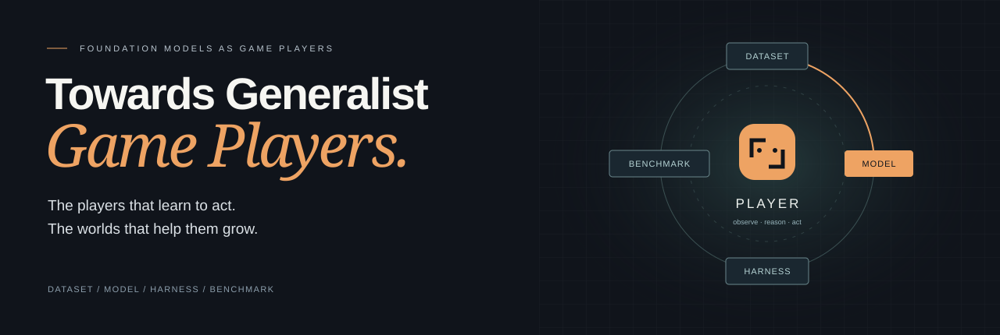

<p align="center">
  <a href="https://thusi-lab.github.io/Awesome-LFMs-Play-Games/">
    
  </a>
</p>

# Towards Generalist Game Players
### A Survey of Foundation Models in the Game Multiverse

<p align="center">
  <a href="https://arxiv.org/abs/2605.09965">📄 Paper</a> &nbsp;·&nbsp;
  <a href="https://thusi-lab.github.io/Awesome-LFMs-Play-Games/">🌐 Project page</a> &nbsp;·&nbsp;
  <a href="https://thusi-lab.github.io/Awesome-LFMs-Play-Games/#library">🔎 Search the collection</a> &nbsp;·&nbsp;
  <a href="https://thusi-lab.github.io/Awesome-LFMs-Play-Games/#environments">🧭 Explore transfer</a> &nbsp;·&nbsp;
  <a href="CONTRIBUTING.md">↗ Contribute</a>
</p>

<p align="center">
  <strong><a href="https://thusi-lab.github.io/Awesome-LFMs-Play-Games/#film">▶ Watch the 90-second film</a></strong><br>
  Players that learn to act. Worlds that help them grow.<br>
  English narration · English and Chinese subtitles
</p>

**Foundation models as players. Game worlds as environments for learning.**

How does one player become more capable across a wider range of games? This collection follows the experience it learns from, the capabilities it acquires, the system it acts through, and the evidence used to evaluate its progress.

Our focus is **players and the environments that help them grow**: interaction, planning, memory, control, adaptation, and transfer. World models and generated environments are included for their potential to support player training, planning, or evaluation. Their value depends on reliable interaction and measurable player improvement.

The collection accompanies **Towards Generalist Game Players: A Survey of Foundation Models in the Game Multiverse**. The [public arXiv preprint](https://arxiv.org/abs/2605.09965) retains the title *An Investigation of Foundation Models in the Game Multiverse*.

**Kuan Zhang\*, Dongchen Liu\*, Qiyue Zhao\*, Tianyu Xin\*, Yue Su\***, Haisheng Wang, Han Yin, Hongbo Ma, Peize Li, Tianjun Gu, Xiangnan Wu, Xinran Zhang, Yongxuan Li, Zirong Chen, Yiming Li†<br>
Tsinghua University · The University of Hong Kong · University of Chinese Academy of Sciences<br>
\* Equal contribution · † Corresponding author

## Choose a research pillar

| Pillar | The question | Explore |
| :--- | :--- | :--- |
| **Dataset** | What experience can the player learn from? | [Reading list](#-dataset) · [Interactive collection](https://thusi-lab.github.io/Awesome-LFMs-Play-Games/?pillar=Dataset#library) |
| **Model** | What can the player understand and do? | [Reading list](#-model) · [Interactive collection](https://thusi-lab.github.io/Awesome-LFMs-Play-Games/?pillar=Model#library) |
| **Harness** | How does capability become reliable play? | [Reading list](#-harness) · [Interactive collection](https://thusi-lab.github.io/Awesome-LFMs-Play-Games/?pillar=Harness#library) |
| **Benchmark** | What evidence shows that the player improved? | [Reading list](#-benchmark) · [Interactive collection](https://thusi-lab.github.io/Awesome-LFMs-Play-Games/?pillar=Benchmark#library) |

## Collection at a glance

**210 unique resources · 257 category records · 32 additions since the April 2026 cutoff**

The repository primarily features work from 2025 onward, with selected earlier foundations. A resource may contribute to several pillars. Counts include related surveys and refer to this reading list, not the manuscript bibliography.

**October 21, 2026 update.** New works include Video-Arena, Scaling in Games / GameScaling, SPIKE, Odysseus, Player-1, GameHorizon Suite, GameWAM, Matrix-Game 4.0, OmniGameArena, AgenticSTS, and recent Slay the Spire benchmarks. The [October catalog](data/literature-2026-10.json) records dates and their precision, summaries, primary sources, and release status. [Browse only these additions →](https://thusi-lab.github.io/Awesome-LFMs-Play-Games/?source=update#library)

**Reading the categories.** Dataset includes corpora and explicitly labeled data-scaling studies; Model includes learned policies and world models; Harness includes planning, memory, control, and adaptation around models; Benchmark includes evaluation protocols. The website labels supporting environments separately from player-focused work. Recorded-video understanding and closed-loop gameplay are distinct; Coachable agents is labeled as related non-LFM RL research.

**Dates and availability.** October additions use first arXiv submission dates or identified official release announcements. Baseline entries retain the dates recorded in the existing reading list. October dataset rows inherit the associated paper's date, which may differ from the artifact release. A repository can be a placeholder: Player-1, GameHorizon, and WorldMind/BOSS-140K have pending resources as of the October review. GameScaling links to its official PDF. The catalog records exceptions and exact provenance.

**Navigate:** [Model](#-model) · [Harness](#-harness) · [Dataset](#-dataset) · [Benchmark](#-benchmark) · [Related surveys](#-survey) · [Roadmap](#-challenges--future-directions) · [Repository guide](#repository-guide) · [Citation](#-citation)

---

## 🤖 Model
*Methods involving Supervised Fine-Tuning (SFT), Reinforcement Learning (RL), or (Continued) Pre-training.*

| Date | Title | Venue | Keywords | Links |
| :--- | :--- | :--- | :--- | :--- |
| 2026/10 | **Matrix-Game 4.0: Harnessing Video Models for Real-Time Playable Game Worlds** | arXiv | Engine-Grounded WM, Causal Neural Rendering, Real-Time Gameplay | [[Paper](https://arxiv.org/abs/2610.27999)] [[Project](https://matrix-game-v4-0.github.io/page/)] [[Code](https://github.com/SkyworkAI/Matrix-Game)] [[Models](https://huggingface.co/Skywork/Matrix-Game-4.0)] |
| 2026/10 | **Player-1: Learning to Play from Synthetic Experience** | arXiv | VLA, Synthetic-Game SFT + PPO, Keyboard/Mouse; Code & Weights Pending | [[Paper](https://arxiv.org/abs/2610.20584)] [[Project](https://player-1-project.github.io/)] [[Repository](https://github.com/TencentARC/Player-1)] |
| 2026/10 | **Scaling in Games: Continued Pre-Training for Embodied Agents in Diverse Virtual Worlds** | Technical report | Continued Pre-Training, 120 Configurations, Cross-Game Transfer, 8 Released Policies | [[Paper](https://gamescaling.github.io/assets/paper.pdf)] [[Project](https://gamescaling.github.io/)] [[Code](https://github.com/THUSI-Lab/GameScaling)] [[Models](https://huggingface.co/THUSI-Lab/GameScaling)] |
| 2026/09 | **GameDirector: Decoupling Gameplay Logic from Rendering for Player-Configurable Game World Models** | arXiv | State-Conditioned Game WM, NPC Control, Neural Rendering | [[Paper](https://arxiv.org/abs/2609.25652)] [[Project](https://jimntu.github.io/gamedirector/)] [[Code](https://github.com/Jimntu/GameDirector_code)] [[Models](https://huggingface.co/onepiece1999/GameDirector)] |
| 2026/09 | **Agora-2: An Action-Conditioned World Model for Real-Time Multiplayer Environments** | Technical report | Action-Conditioned Multiplayer WM, Shared State, Diablo II | [[Paper](https://agora-2.odyssey.systems/agora-2.pdf)] [[Project](https://odyssey.systems/introducing-agora-2)] |
| 2026/09 | **Introducing Odyssey-3: A General-Purpose Physical Intelligence** | Research announcement | Frozen WM Backbone, Learned Gameplay Action Decoders, GTA V; Research Preview | [[Project](https://odyssey.systems/introducing-odyssey-3)] |
| 2026/08 | **GameWAM: A World Action Model for Video Games** | arXiv | WAM, Joint Video/Action Training, Action-Only Inference | [[Paper](https://arxiv.org/abs/2608.26200)] [[Project](https://yunncheng.github.io/GameWAM/)] [[Code](https://github.com/yunncheng/GameWAM)] [[Models](https://huggingface.co/Yunncheng/gamewam-models)] |
| 2026/08 | **WorldMind: Decoupled Game World Model for State-Aware NPC Behavior** | arXiv | Decoupled Game WM, State-Aware NPCs; Weights Pending | [[Paper](https://arxiv.org/abs/2608.21439)] [[Project](https://teawhite.cn/WorldMind/)] [[Repository](https://github.com/TeaWhiteBro/WorldMind)] |
| 2026/07 | **StatePlay: State-Aware Game World Models for Mechanics-Consistent Generation** | arXiv | State-Aware WM, Joint Frame/State Prediction, Mechanics Consistency | [[Paper](https://arxiv.org/abs/2607.26754)] [[Project](https://jimntu.github.io/stateplay_page/)] [[Code](https://github.com/Jimntu/StatePlay)] [[Models](https://huggingface.co/onepiece1999/StatePlay)] |
| 2026/07 | **ActSWM: Action-Sensitive World Models for Long-Horizon Planning in Open-World Games** | arXiv | Latent WM, Action Sensitivity, Long-Horizon Planning, Minecraft | [[Paper](https://arxiv.org/abs/2607.26712)] |
| 2026/07 | **Coachable agents for interactive gameplay** | arXiv | Related Non-LFM RL, Style-Conditioned Policies, Runtime Coaching, HFW / GT7 / Humanoid | [[Paper](https://arxiv.org/abs/2607.00642)] [[Code (humanoid)](https://github.com/SonyResearch/coachable_agents)] |
| 2026/05 | **SCOPE: Simulating Cross-game Operations in Playable Environments for FPS World Models** | arXiv | FPS World Model, Spatially Selective Action Conditioning, Cross-Game Transfer | [[Paper](https://arxiv.org/abs/2605.23345)] [[Project](https://z2tong.github.io/SCOPE/)] [[Code](https://github.com/z2tong/SCOPE)] |
| 2026/05 | **Agora-1: The Multi-Agent World Model** | Research announcement | Multiplayer WM, Shared Simulation, Separate State/Rendering, GoldenEye | [[Project](https://odyssey.systems/introducing-agora-1)] |
| 2026/05 | **ReactiveGWM: Flexible Control and NPC Reactivity in Game World Models** | arXiv | Reactive NPCs, Spatial Character Binding, Flexible Action/Rule Control; v2 Oct 2026 | [[Paper](https://arxiv.org/abs/2605.15256)] [[Project](https://inv-wzq.github.io/ReactiveGWM/)] [[Code](https://github.com/INV-WZQ/ReactiveGWM)] [[Models](https://huggingface.co/INV-WZQ/ReactiveGWM-v2-Models)] |
| 2026/05 | **Odysseus: Scaling VLMs to 100+ Turn Decision-Making in Games via Reinforcement Learning** | COLM 2026 | VLM Policy, PPO, Turn-Level CNN Critic, 100+ Turns, Mario, Cross-Game Transfer | [[Paper](https://arxiv.org/abs/2605.00347)] [[Project](https://odysseus-project.github.io/)] [[Code](https://github.com/odysseus-project/odysseus-mario-training)] [[Models](https://huggingface.co/collections/Odysseus-Project/odysseus)] |
| 2026/04 | **Matrix-Game 3.0: Real-Time and Streaming Interactive World Model with Long-Horizon Memory** | arXiv | Long-Horizon Memory, Distribution Matching Distillation, 720p Real-Time Generation | [[Paper](https://arxiv.org/abs/2604.08995)] [[Code](https://github.com/SkyworkAI/Matrix-Game)] |
| 2026/03 | **WorldCam: Interactive Autoregressive 3D Gaming Worlds with Camera Pose as a Unifying Geometric Representation** | arXiv | Camera Pose Control, Long-Horizon 3D Consistency, Autoregressive World Model | [[Paper](https://arxiv.org/abs/2603.16871)] [[Code](https://github.com/cvlab-kaist/WorldCam)] |
| 2026/03 | **Proact-VL: A Proactive VideoLLM for Real-Time AI Companions** | arXiv | Proactive VideoLLM, Real-Time Streaming, SFT | [[Paper](https://arxiv.org/abs/2603.03447)] [[Code](https://github.com/microsoft/AnthropomorphicIntelligence/tree/main/Proact-VL)] |
| 2026/02 | **Solaris: Building a Multiplayer Video World Model in Minecraft** | arXiv | Multiplayer World Model, Cross-Player Consistency, Self Forcing | [[Paper](https://arxiv.org/abs/2602.22208)] [[Code](https://github.com/solaris-wm/solaris)] |
| 2026/02 | **MAIN-VLA: Modeling Abstraction of Intention and eNvironment for Vision-Language-Action Models** | arXiv | VLA, Intention Modeling, SFT | [[Paper](https://arxiv.org/abs/2602.02212)] |
| 2026/02 | **VAM: Verbalized Action Masking for Controllable Exploration in RL Post-Training -- A Chess Case Study** | arXiv | Action Masking, RL Post-Training, Chess | [[Paper](https://arxiv.org/abs/2602.16833)] |
| 2026/02 | **Implicit Strategic Optimization: Rethinking Long-Horizon Decision-Making in Adversarial Poker Environments** | arXiv | GRPO, Long-Horizon RL, Poker | [[Paper](https://arxiv.org/abs/2602.08041)] |
| 2026/02 | **Mixture of Masters: Sparse Chess Language Models with Player Routing** | arXiv | MoE, RL Fine-tuning, Chess | [[Paper](https://arxiv.org/abs/2602.04447)] |
| 2026/01 | **NitroGen: An Open Foundation Model for Generalist Gaming Agents** | arXiv | Behavior Cloning, Flow Matching, DiT | [[Paper](https://arxiv.org/abs/2601.02427)] [[Code](https://github.com/MineDojo/NitroGen)] |
| 2026/01 | **Scaling Behavior Cloning Improves Causal Reasoning: An Open Model for Real-Time Video Game Playing** | arXiv | Behavior Cloning, Scaling Law, Causal Reasoning | [[Paper](https://arxiv.org/abs/2601.04575)] [[Code](https://github.com/elefant-ai/open-p2p)] |
| 2026/01 | **GameTalk: Training LLMs for Strategic Conversation** | arXiv | GRPO/DPO, Strategic Dialogue | [[Paper](https://arxiv.org/abs/2601.16276)] |
| 2025/12 | **Training One Model to Master Cross-Level Agentic Actions via Reinforcement Learning** | arXiv | SFT + GRPO, Cross-Level Action Space | [[Paper](https://arxiv.org/abs/2512.09706)] [[Code](https://github.com/CraftJarvis/OpenHA)] |
| 2025/12 | **SIMA 2: A Generalist Embodied Agent for Virtual Worlds** | arXiv | Gemini Fine-tuning, Cross-World Transfer | [[Paper](https://arxiv.org/abs/2512.04797)] [[Project](https://deepmind.google/discover/blog/sima-2-an-agent-that-plays-reasons-and-learns-with-you-in-virtual-3d-worlds/)] |
| 2025/11 | **IPR-1: Interactive Physical Reasoner** | arXiv | Prediction-Reinforced Reasoning, PhysCode, Game-to-Unseen Benchmark | [[Paper](https://arxiv.org/abs/2511.15407)] [[Code](https://github.com/mybearyZhang/ipr-1)] |
| 2025/11 | **PAN: A World Model for General, Interactable, and Long-Horizon World Simulation** | arXiv | General World Model, Language-Conditioned Actions, Long-Horizon Simulation | [[Paper](https://arxiv.org/abs/2511.09057)] |
| 2025/11 | **Lumine: An Open Recipe for Building Generalist Agents in 3D Open Worlds** | arXiv | SFT, Cross-Game Transfer, Genshin Impact | [[Paper](https://arxiv.org/abs/2511.08892)] |
| 2025/10 | **Game-TARS: Pretrained Foundation Models for Scalable Generalist Multimodal Game Agents** | arXiv | Pre-training, Unified Action Space | [[Paper](https://arxiv.org/abs/2510.23691)] [[Project](https://seed-tars.com/game-tars/)] |
| 2025/10 | **Learning to Play: A Multimodal Agent for 3D Game-Play** | arXiv | VLA, Behavior Cloning, 3D Game-Play | [[Paper](https://arxiv.org/abs/2510.16774)] |
| 2025/10 | **Stronger-MAS: Multi-Agent Reinforcement Learning for Collaborative LLMs** | arXiv | Multi-Agent GRPO, Collaborative RL | [[Paper](https://openreview.net/forum?id=IdF6JqXWzx)] [[Code](https://github.com/pettingllms-ai/PettingLLMs)] |
| 2025/10 | **MARSHAL: Incentivizing Multi-Agent Reasoning via Self-Play with Strategic LLMs** | arXiv | Self-Play RL, Strategic Transfer | [[Paper](https://arxiv.org/abs/2510.15414)] [[Code](https://github.com/thu-nics/MARSHAL)] |
| 2025/09 | **OpenHA: A Series of Open-Source Hierarchical Agentic Models in Minecraft** | arXiv | SFT, Chain of Action, Hierarchical VLA | [[Paper](https://arxiv.org/abs/2509.13347)] [[Code](https://github.com/CraftJarvis/OpenHA)] |
| 2025/09 | **SpinGPT: A Large-Language-Model Approach to Playing Poker Correctly** | ACG 2025 | SFT + RL, Poker | [[Paper](https://arxiv.org/abs/2509.22387)] |
| 2025/09 | **UI-TARS-2 Technical Report: Advancing GUI Agent with Multi-Turn Reinforcement Learning** | arXiv | Multi-Turn RL, GUI Agent | [[Paper](https://arxiv.org/abs/2509.02544)] [[Code](https://github.com/bytedance/UI-TARS)] |
| 2025/08 | **Matrix-game 2.0: An open-source real-time and streaming interactive world model** | arXiv | Few-Step Autoregressive Diffusion, Streaming Generation, Action Injection | [[Paper](https://arxiv.org/abs/2508.13009)] [[Code](https://github.com/SkyworkAI/Matrix-Game/)] |
| 2025/08 | **Think in Games: Learning to Reason in Games via Reinforcement Learning with Large Language Models** | arXiv | RL Training, Game Reasoning | [[Paper](https://arxiv.org/abs/2508.21365)] |
| 2025/08 | **Reinforced Language Models for Sequential Decision Making** | arXiv | Multi-step GRPO, Credit Assignment | [[Paper](https://arxiv.org/abs/2508.10839)] |
| 2025/08 | **Enhancing Vision-Language Model Training with Reinforcement Learning in Synthetic Worlds for Real-World Success** | arXiv | VLM + RL, Synthetic Environment | [[Paper](https://arxiv.org/abs/2508.04280)] |
| 2025/06 | **Play to Generalize: Learning to Reason Through Game Play** | arXiv | RL, Game→Reasoning Transfer | [[Paper](https://arxiv.org/abs/2506.08011)] [[Project](https://yunfeixie233.github.io/ViGaL/)] |
| 2025/06 | **Matrix-Game: Interactive World Foundation Model** | arXiv | Image-to-World Generation, Large-Scale Minecraft Pretraining, Action Controllability | [[Paper](https://arxiv.org/abs/2506.18701)] [[Code](https://github.com/SkyworkAI/Matrix-Game)] |
| 2025/05 | **Game-RL: Synthesizing Multimodal Verifiable Game Data to Boost VLMs' General Reasoning** | arXiv | RL, Code2Logic, Verifiable Reward | [[Paper](https://arxiv.org/abs/2505.13886)] |
| 2025/05 | **Towards Efficient Online Tuning of VLM Agents via Counterfactual Soft Reinforcement Learning** | ICML 2025 | Counterfactual Soft RL, Online Tuning | [[Paper](https://openreview.net/forum?id=H76PMm7hf2)] [[Code](https://github.com/langfengQ/CoSo)] |
| 2025/05 | **G1: Bootstrapping Perception and Reasoning Abilities of Vision-Language Model via Reinforcement Learning** | arXiv | Visual RL, VLM-Gym | [[Paper](https://arxiv.org/abs/2505.13426)] [[Code](https://github.com/chenllliang/G1)] |
| 2025/04 | **MineWorld: a Real-Time and Open-Source Interactive World Model on Minecraft** | arXiv | Visual-Action Autoregressive Transformer, Parallel Decoding, Action Following | [[Paper](https://arxiv.org/abs/2504.08388)] [[Code](https://github.com/microsoft/mineworld)] |
| 2025/04 | **UI-TARS-1.5** | Research blog | VLA, GUI Agent, Game Reasoning | [[Project](https://seed-tars.com/1.5)] [[Code](https://github.com/bytedance/UI-TARS)] |
| 2025/04 | **WHAMM! Real-time world modelling of interactive environments.** | Research blog | MaskGIT World Model, Real-Time Gameplay, Quake II Transfer | [[Paper](https://www.microsoft.com/en-us/research/articles/whamm-real-time-world-modelling-of-interactive-environments/)] |
| 2025/03 | **JARVIS-VLA: Post-Training Large-Scale Vision Language Models to Play Visual Games with Keyboards and Mouse** | ACL Findings 2025 | VLA Post-Training, Minecraft | [[Paper](https://aclanthology.org/2025.findings-acl.920/)] [[Code](https://github.com/CraftJarvis/JarvisVLA)] |
| 2025/03 | **CombatVLA: An Efficient Vision-Language-Action Model for Combat Tasks in 3D Action Role-Playing Games** | ICCV 2025 | VLA, SFT, Combat ARPG | [[Paper](https://openaccess.thecvf.com/content/ICCV2025/html/Chen_CombatVLA_An_Efficient_Vision-Language-Action_Model_for_Combat_Tasks_in_3D_ICCV_2025_paper.html)] [[Code](https://github.com/ChenVoid/CombatVLA)] |
| 2025/03 | **Model as a Game: On Numerical and Spatial Consistency for Generative Games** | ICCV Workshop 2025 | Numerical Consistency, Spatial Consistency, LogicNet + Spatial Memory | [[Paper](https://arxiv.org/abs/2503.21172)] |
| 2025/02 | **World and Human Action Models towards gameplay ideation** | Nature | Gameplay Ideation, Human Action Modeling, Consistency/Diversity/Persistency | [[Paper](https://www.nature.com/articles/s41586-025-08600-3)] [[Code](https://huggingface.co/microsoft/wham)]|
| 2025/02 | **Learning Strategic Language Agents in the Werewolf Game with Iterative Latent Space Policy Optimization** | ICML 2025 | Werewolf, Latent Space Policy, CFR, DPO, Strategic Communication | [[Paper](https://openreview.net/forum?id=N2mOBiSqhc)] |
| 2025/01 | **GameFactory: Creating New Games with Generative Interactive Videos** | ICCV 2025 | Scene-Generalizable Control, Open-Domain Game Generation, Multi-Phase Training | [[Paper](https://openaccess.thecvf.com/content/ICCV2025/html/Yu_GameFactory_Creating_New_Games_with_Generative_Interactive_Videos_ICCV_2025_paper.html)] [[Code](https://github.com/KlingAIResearch/GameFactory)] |
| 2025/01 | **UI-TARS: Pioneering Automated GUI Interaction with Native Agents** | arXiv | SFT, System-2 Reasoning, GUI Agent | [[Paper](https://arxiv.org/abs/2501.12326)] [[Code](https://github.com/bytedance/UI-TARS)] |
| 2024/12 | **Playable Game Generation** | arXiv | Autoregressive DiT, Playability Evaluation, Real-Time Mechanics Simulation | [[Paper](https://arxiv.org/abs/2412.00887)] [[Code](https://github.com/GreatX3/Playable-Game-Generation)] |
| 2024/11 | **GameGen-X: Interactive Open-world Game Video Generation** | ICLR 2025 | Open-World Game Video Generation, Multi-Modal Control, Instruction Tuning | [[Paper](https://openreview.net/forum?id=8VG8tpPZhe)] [[Code](https://github.com/GameGen-X/GameGen-X)]|
| 2024/10 | **Scaling Offline Model-Based RL via Jointly-Optimized World-Action Model Pretraining** | ICLR 2025 | Joint World-Action Pretraining, Offline Model-Based RL, Multi-Game Atari Transfer | [[Paper](https://proceedings.iclr.cc/paper_files/paper/2025/hash/689cffc97600f9deb8374fc8fa918b8e-Abstract-Conference.html)] [[Code](https://github.com/CJReinforce/JOWA)]|
| 2024/10 | **ROCKET-1: Mastering Open-World Interaction with Visual-Temporal Context Prompting** | CVPR 2025 | Hierarchical VLM, Visual-Temporal Prompting | [[Paper](https://arxiv.org/abs/2410.17856)] [[Code](https://github.com/CraftJarvis/ROCKET-1)] |
| 2024/08 | **Diffusion Models Are Real-Time Game Engines** | ICLR 2025 | DOOM Neural Game Engine, Diffusion World Model, RL Gameplay Data | [[Paper](https://openreview.net/forum?id=P8pqeEkn1H)] [[Project](https://gamengen.github.io/)]|
| 2024/07 | **OmniJARVIS: Unified Vision-Language-Action Tokenization Enables Open-World Instruction Following Agents** | NeurIPS 2024 | VLA Tokenization, Imitation Learning | [[Paper](https://proceedings.neurips.cc/paper_files/paper/2024/hash/85f1225db986e629289f402c46eff1a4-Abstract-Conference.html)] [[Code](https://github.com/CraftJarvis/OmniJARVIS)] |
| 2024/06 | **DigiRL: Training In-The-Wild Device-Control Agents with Autonomous Reinforcement Learning** | NeurIPS 2024 | Autonomous RL, VLM Fine-tuning | [[Paper](https://proceedings.neurips.cc/paper_files/paper/2024/hash/1704ddd0bb89f159dfe609b32c889995-Abstract-Conference.html)] [[Project](https://digirl-agent.github.io/)] [[Code](https://github.com/DigiRL-agent/digirl)] |
| 2024/06 | **Aligning Agents like Large Language Models** | arXiv | Agent Alignment, RLHF-style | [[Paper](https://arxiv.org/abs/2406.04208)] [[Code](https://adamjelley.github.io/aligning-agents-like-llms/)] |
| 2024/03 | **Scaling Instructable Agents Across Many Simulated Worlds** | arXiv | Instructable Agent, Cross-World Transfer, Keyboard-Mouse Actions | [[Paper](https://arxiv.org/abs/2404.10179)] |
| 2024/02 | **Genie: Generative Interactive Environments** | ICML 2024 | Latent Action Modeling, Unsupervised Video Learning, Foundation World Model | [[Paper](https://arxiv.org/abs/2402.15391)] [[Project](https://sites.google.com/view/genie-2024/)] |
| 2023/12 | **Creative Agents: Empowering Agents with Imagination for Creative Tasks** | arXiv | VLM, Goal Image Generation, Minecraft | [[Paper](https://arxiv.org/abs/2312.02519)] |
| 2023/10 | **Language Agents with Reinforcement Learning for Strategic Play in the Werewolf Game** | ICML 2024 | Werewolf, RL Policy, Social Deduction, LLM + RL, Strategic Play | [[Paper](https://icml.cc/virtual/2024/poster/32805)] |
| 2023/10 | **LLaMA-Rider: Spurring Large Language Models to Explore the Open World** | NAACL Findings 2024 | SFT, Exploration, Minecraft | [[Paper](https://aclanthology.org/2024.findings-naacl.292/)] [[Code](https://github.com/PKU-RL/LLaMA-Rider)] |
| 2023/10 | **GROOT: Learning to Follow Instructions by Watching Gameplay Videos** | ICLR 2024 | Video-Conditioned Imitation, Causal Transformer | [[Paper](https://proceedings.iclr.cc/paper_files/paper/2024/hash/16986b69068fbe6acf64eb6566519c74-Abstract-Conference.html)] [[Code](https://github.com/CraftJarvis/GROOT)] |
| 2023/06 | **STEVE-1: A Generative Model for Text-to-Behavior in Minecraft** | NeurIPS 2023 | Behavioral Cloning, Hindsight Relabeling | [[Paper](https://arxiv.org/abs/2306.00937)] [[Code](https://github.com/Shalev-Lifshitz/STEVE-1)] |
| 2022/06 | **Video PreTraining (VPT): Learning to Act by Watching Unlabeled Online Videos** | NeurIPS 2022 | Semi-Supervised IL + RL, Inverse Dynamics | [[Paper](https://proceedings.neurips.cc/paper_files/paper/2022/hash/9c7008aff45b5d8f0973b23e1a22ada0-Abstract-Conference.html)] [[Code](https://github.com/openai/Video-Pre-Training)] |
| 2022/06 | **MineDojo: Building Open-Ended Embodied Agents with Internet-Scale Knowledge** | NeurIPS 2022 | Pre-training, Multi-Task RL | [[Paper](https://proceedings.neurips.cc/paper_files/paper/2022/hash/74a67268c5cc5910f64938cac4526a90-Abstract-Datasets_and_Benchmarks.html)] [[Code](https://github.com/MineDojo/MineDojo)] |
| 2021/04 | **Counter-Strike Deathmatch with Large-Scale Behavioural Cloning** | CoG 2022 | Large-Scale Behavioral Cloning, FPS, Pixel-to-Action | [[Paper](https://ieeexplore.ieee.org/document/9893617)] [[Code](https://github.com/TeaPearce/Counter-Strike_Behavioural_Cloning)]|

---

## 🔧 Harness
*Methods focusing on Prompt Engineering, In-Context Learning, RAG, Agent Harness and Multi-Agent Cooperation.*

| Date | Title | Venue | Keywords | Links |
| :--- | :--- | :--- | :--- | :--- |
| 2026/10 | **Matrix-Game 4.0: Harnessing Video Models for Real-Time Playable Game Worlds** | arXiv | Executable Game Engine, Coding-Agent Orchestration, Neural Renderer | [[Paper](https://arxiv.org/abs/2610.27999)] [[Project](https://matrix-game-v4-0.github.io/page/)] [[Code](https://github.com/SkyworkAI/Matrix-Game)] |
| 2026/10 | **Slay the Spire — A Long-Horizon Reasoning Benchmark** | Research blog | Karotte RL Framework, Headless StS, MCP Tools, Mechanic Lookup, Rollout Logging | [[Report](https://www.preferencemodel.com/blog/slay-the-spire/)] [[Project](https://ai-plays-slay-the-spire.com/)] |
| 2026/10 | **SpireBench: Evaluating Long-Horizon Strategic Play of Agentic Models with Slay the Spire** | arXiv | Full-Game Tool Interface, Batched Actions, State Diffs, Cross-Run Memory | [[Paper](https://arxiv.org/abs/2610.12596)] |
| 2026/10 | **Can AI Agents Learn Their Way to the Top? Evaluating Heuristic Learning in a Long-Running Game Agent Competition** | arXiv | Opponent Selection, Replay Analysis, Executable Policy Improvement | [[Paper](https://arxiv.org/abs/2610.12341)] [[Project](https://aaarena.net/)] [[Code](https://github.com/THU-CST-SAST/AAArena)] |
| 2026/09 | **GameDirector: Decoupling Gameplay Logic from Rendering for Player-Configurable Game World Models** | arXiv | Explicit State & Rules, NPC Planning, Decoupled Rendering | [[Paper](https://arxiv.org/abs/2609.25652)] [[Project](https://jimntu.github.io/gamedirector/)] [[Code](https://github.com/Jimntu/GameDirector_code)] |
| 2026/08 | **WorldMind: Decoupled Game World Model for State-Aware NPC Behavior** | arXiv | State Reconstruction, LLM NPC Planning, Closed-Loop World Simulation; Code Pending | [[Paper](https://arxiv.org/abs/2608.21439)] [[Project](https://teawhite.cn/WorldMind/)] [[Repository](https://github.com/TeaWhiteBro/WorldMind)] |
| 2026/07 | **Compiled Agency: Coding Agents as Game AI Researchers -- from a Roguelike to StarCraft II and Civilization** | arXiv | Coding Agents, Develop–Freeze–Evaluate, Standalone Controllers | [[Paper](https://arxiv.org/abs/2609.18996)] |
| 2026/07 | **AgenticSTS: A Bounded-Memory Testbed for Long-Horizon LLM Agents** | arXiv | Bounded Typed Memory, Episodic Retrieval, Strategic Skills, Slay the Spire 2 | [[Paper](https://arxiv.org/abs/2607.02255)] [[Project](https://alayalab.github.io/AgenticSTS/)] [[Code](https://github.com/AlayaLab/AgenticSTS)] |
| 2026/06 | **Environment-Grounded Automated Prompt Optimization for LLM Game Agents** | arXiv | Prompt Optimization, Perception/Action Decomposition, Evolutionary Search, BabyAI | [[Paper](https://arxiv.org/abs/2606.17838)] [[Code](https://github.com/ReanFernandes/rapoa)] |
| 2026/06 | **OmniGameArena: A Unified UE5 Benchmark for VLM Game Agents with Improvement Dynamics** | arXiv | IDC, Repeated-Round Reflection, Skill-Prompt Refinement | [[Paper](https://arxiv.org/abs/2606.09826)] [[Project](https://mxlin043.github.io/OmniGameArena/)] [[Code](https://github.com/mxlin043/OmniGameArena)] |
| 2026/05 | **PTCG-Bench: Can LLM Agents Master Pokémon Trading Card Game?** | EMNLP 2026 Findings | Modular Agent Harness, Experience Accumulation, Self-Evolution | [[Paper](https://arxiv.org/abs/2605.29653)] [[Code](https://github.com/zjunet/PTCG-Bench)] |
| 2026/05 | **APEX: Autonomous Policy Exploration for Self-Evolving LLM Agents** | arXiv | Strategy DAG, Exploration Management, Cross-Episode Self-Evolution, Jericho | [[Paper](https://arxiv.org/abs/2605.21240)] [[Code](https://github.com/liushiliushi/APEX1)] |
| 2026/05 | **SPIKE: An Adaptive Dual Controller Framework for Cost-Efficient Long-Horizon Game Agents** | arXiv | Adaptive Dual Controllers, Event-Triggered Planning, Memory, Stardew Valley | [[Paper](https://arxiv.org/abs/2605.18636)] [[Project](https://wencanjiang.github.io/projects/SPIKE/)] [[Code](https://github.com/wencanjiang/SPIKE)] |
| 2026/05 | **Continual Harness: Online Adaptation for Self-Improving Foundation Agents** | arXiv | Reset-Free Adaptation, Prompts, Subagents, Skills, Memory, Pokémon | [[Paper](https://arxiv.org/abs/2605.09998)] [[Project](https://sethkarten.ai/continual-harness/)] [[Code](https://github.com/sethkarten/continual-harness)] |
| 2026/03 | **GameVerse: Can Vision-Language Models Learn from Video-based Reflection?** | arXiv | VLM, Video Reflection, 15 Games | [[Paper](https://arxiv.org/abs/2603.06656)] [[Code](https://github.com/THUSI-Lab/GameVerse)] |
| 2026/03 | **The PokeAgent Challenge: Competitive and Long-Context Learning at Scale** | NeurIPS 2025 Competition Track | Textual Environment, Battle Data Augmentation, Reasoning Mode, Time Adaption | [[Paper](https://arxiv.org/abs/2603.15563)] [[Code](https://github.com/sethkarten/pokeagent-speedrun)] |
| 2026/03 | **Resource-constrained Amazons chess decision framework integrating large language models and graph attention** | arXiv | LLM Distillation, Specialized Model | [[Paper](https://arxiv.org/abs/2603.10512)] |
| 2026/03 | **Steve-Evolving: Open-World Embodied Self-Evolution via Fine-Grained Diagnosis and Dual-Track Knowledge Distillation** | arXiv | Reflection, Skill Library | [[Paper](https://arxiv.org/abs/2603.13131v1)] [[Code](https://github.com/xzw-ustc/Steve-Evolving)] |
| 2026/02 | **ProxyWar: Dynamic Assessment of LLM Code Generation in Game Arenas** | ICSE 2026 | LLM codes modules for game playing | [[Paper](https://conf.researchr.org/details/icse-2026/icse-2026-research-track/178/ProxyWar-Dynamic-Assessment-of-LLM-Code-Generation-in-Game-Arenas)] [[Code](https://github.com/xinke-wang/ProxyWar)] |
| 2026/01 | **BotzoneBench: Scalable LLM Evaluation via Graded AI Anchors** | arXiv | Textual Environment | [[Paper](https://arxiv.org/abs/2602.13214)] [[Code](https://github.com/AMysteriousBeing/BotzoneBench)] |
| 2025/12 | **Do Persona-Infused LLMs Affect Performance in a Strategic Reasoning Game?** | IJCNLP-AACL 2025 | Persona Prompting | [[Paper](https://aclanthology.org/2025.ijcnlp-long.186/)] |
| 2025/11 | **Real-Time Reasoning Agents in Evolving Environments** | arXiv | Real-Time Reasoning, Multi-Agent | [[Paper](https://arxiv.org/abs/2511.04898)] [[Code](https://github.com/SALT-NLP/RealtimeGym)] |
| 2025/10 | **Code World Models for General Game Playing** | ICLR 2016 | LLM codes modules for game playing | [[Paper](https://openreview.net/forum?id=1UoB7IWiku)] |
| 2025/09 | **Leveraging LLM Agents for Automated Video Game Testing** | arXiv | Textual environment | [[Paper](https://arxiv.org/abs/2509.22170)] |
| 2025/09 | **FlashAdventure: A Benchmark for GUI Agents Solving Full Story Arcs in Diverse Adventure Games** | EMNLP 2025 | Memory, Subtask | [[Paper](https://aclanthology.org/2025.emnlp-main.1192/)] [[Code](https://github.com/ahnjaewoo/FlashAdventure)] |
| 2025/08 | **DeepPHY: Benchmarking Agentic VLMs on Physical Reasoning** | arXiv | Action Interface, Observation Augmentation | [[Paper](https://arxiv.org/abs/2508.05405)] [[Code](https://github.com/XinrunXu/DeepPHY)] |
| 2025/08 | **VistaWise: Building Cost-Effective Agent with Cross-Modal Knowledge Graph for Minecraft** | EMNLP 2025 | Cross-modal RAG, Memory, Skill Library | [[Paper](https://aclanthology.org/2025.emnlp-main.1111/)] |
| 2025/07 | **General Modular Harness for LLM Agents in Multi-Turn Gaming Environments** | ICML MAS workshop | Memory, Reflection, Workflow | [[paper](https://arxiv.org/abs/2507.11633)] |
| 2025/06 | **Orak: A Foundational Benchmark for Training and Evaluating LLM Agents on Diverse Video Games** | ICLR 2026 | MCP, Reflection | [[Paper](https://iclr.cc/virtual/2026/poster/10010438)] [[Code](https://github.com/krafton-ai/Orak)]|
| 2025/06 | **VS-Bench: Evaluating VLMs for Strategic Abilities in Multi-Agent Environments** | arXiv | CoT | [[Paper](https://arxiv.org/abs/2506.02387)] [[Code](https://github.com/zelaix/VS-Bench)] |
| 2025/05 | **lmgame-Bench: How Good are LLMs at Playing Games?** | ICLR 2026 | Textual Environment, Memory, Reflection, CoT, Action Interface | [[Paper](https://openreview.net/forum?id=qeziG97WUZ)] [[Code](https://github.com/lmgame-org/GamingAgent)] |
| 2025/05 | **Learning to Play Like Humans: A Framework for LLM Adaptation in Interactive Fiction Games** | ACL Findings 2025 | Interactive Fiction games, RAG, CoT | [[Paper](https://aclanthology.org/2025.findings-acl.531/)] |
| 2025/05 | **VideoGameBench: Can Vision-Language Models complete popular video games?** | arXiv | Action Interface, ReAct, Pause, Text Memory | [[Paper](https://arxiv.org/abs/2505.18134)] [[Code](https://github.com/alexzhang13/videogamebench)] |
| 2025/03 | **Cultivating Gaming Sense for Yourself: Making VLMs Gaming Experts** | ACL 2025 | VLM codes modules for game playing | [[Paper](https://aclanthology.org/2025.acl-long.643/)] [[Code](https://github.com/ipsss2/GameSense)] |
| 2025/03 | **DSGBench: A Diverse Strategic Game Benchmark for Evaluating LLM-based Agents in Complex Decision-Making Environments** | arXiv | Textual Environment | [[Paper](https://arxiv.org/abs/2503.06047)] [[Code](https://github.com/DeciBrain-Group/DSGBench)] |
| 2025/02 | **Reflection of Episodes: Learning to Play Game from Expert and Self Experiences** | arXiv | Reflection, Key frame, Text StarCraft II | [[Paper](https://arxiv.org/abs/2502.13388)] |
| 2024/12 | **GAMEBoT: Transparent Assessment of LLM Reasoning in Games** | ACL 2025 | CoT | [[Paper](https://aclanthology.org/2025.acl-long.378/)] [[Code](https://github.com/Visual-AI/GAMEBoT)]|
| 2024/09 | **Can VLMs Play Action Role-Playing Games? Take Black Myth Wukong as a Study Case** | arXiv   | Reflection, Workflow, Human trajectory                       | [[Paper](https://arxiv.org/abs/2409.12889)] [[Project](https://varp-agent.github.io/)] |
| 2024/05 | **Self-Reflection in Large Language Model Agents: Effects on Problem-Solving Performance** | FLLM 2024 | Self-Reflection | [[Paper](https://ieeexplore.ieee.org/document/10852426)] [[Code](https://github.com/matthewrenze/self-reflection)] |
| 2024/03 | **Cradle: Empowering Foundation Agents towards General Computer Control** | ICML 2025 | Reflection, RAG, Workflow                                    | [[Paper](https://proceedings.mlr.press/v267/tan25h.html)] [[Code](https://github.com/BAAI-Agents/Cradle)] |
| 2023/12 | **Large Language Models Play StarCraft II: Benchmarks and A Chain of Summarization Approach** | NeurIPS 2024 | Textual environment, Chain-of-Summarization | [[Paper](https://proceedings.neurips.cc/paper_files/paper/2024/hash/f0ebc318e2df08360b2df559e81602e5-Abstract-Conference.html)] [[Code](https://github.com/histmeisah/large-language-models-play-starcraftii)] |
| 2023/11 | **JARVIS-1: Open-World Multi-task Agents with Memory-Augmented Multimodal Language Models** | arXiv | Memory-Augmented LLM, Multimodal Planning, Minecraft | [[Paper](https://arxiv.org/abs/2311.05997)] [[Code](https://github.com/CraftJarvis/JARVIS-1)] |
| 2023/08 | **AgentVerse: Facilitating Multi-Agent Collaboration and Exploring Emergent Behaviors** | ICLR 2024 | Multi-Agent | [[Paper](https://openreview.net/forum?id=EHg5GDnyq1)] [[Code](https://github.com/OpenBMB/AgentVerse)] |
| 2023/05 | **Voyager: An Open-Ended Embodied Agent with Large Language Models** | NeurIPS 2023 Workshop IMOL | Textual environment,LLM coding, RAG(skill storage), Reflection | [[Publication](https://nips.cc/virtual/2023/77597)] [[Code](https://github.com/MineDojo/Voyager)] |
| 2023/02 | **Describe, Explain, Plan and Select: Interactive Planning with Large Language Models Enables Open-World Multi-Task Agents** | NeurIPS 2023 | Zero-Shot LLM Planning, Interactive Refinement, Minecraft | [[Paper](https://proceedings.neurips.cc/paper_files/paper/2023/hash/6b8dfb8c0c12e6fafc6c256cb08a5ca7-Abstract-Conference.html)] [[Code](https://github.com/CraftJarvis/MC-Planner)] |
| 2022/10 | **ReAct: Synergizing Reasoning and Acting in Language Models** | ICLR 2023 | ReAct, Chain-of-Thought (CoT) | [[Paper](https://openreview.net/forum?id=WE_vluYUL-X)] [[Code](https://github.com/ysymyth/ReAct)]|


---

## 💾 Dataset
*Large-scale corpora or environment states used for training or analysis.*

| Date | Title | Venue | Keywords | Links |
| :--- | :--- | :--- | :--- | :--- |
| 2026/10 | **Player-1: Learning to Play from Synthetic Experience** | arXiv | Player-1-Data, 6,044 Trajectories, 172 Games; Release Pending | [[Paper](https://arxiv.org/abs/2610.20584)] [[Project](https://player-1-project.github.io/)] [[Repository](https://github.com/TencentARC/Player-1)] |
| 2026/10 | **Video-Arena: A Scalable Agentic Video Benchmark for Spatiotemporal Capability** | arXiv | Evaluation Videos & Ground Truth, 180 Cases, 9 Games | [[Paper](https://arxiv.org/abs/2610.14158)] [[Project](https://videoarena-bench.github.io/)] [[Code](https://github.com/THUSI-Lab/VideoArena)] [[Data](https://huggingface.co/datasets/THUSI-Lab/Video-Arena)] |
| 2026/10 | **Can AI Agents Learn Their Way to the Top? Evaluating Heuristic Learning in a Long-Running Game Agent Competition** | arXiv | 1,920 Archived Human Programs; Public Subset: 909 Packages | [[Paper](https://arxiv.org/abs/2610.12341)] [[Project](https://aaarena.net/)] [[Code](https://github.com/THU-CST-SAST/AAArena)] |
| 2026/10 | **Scaling in Games: Continued Pre-Training for Embodied Agents in Diverse Virtual Worlds** | Technical report | Data-Scaling Study, Volume vs. Game Diversity; Training Corpus Not Released | [[Paper](https://gamescaling.github.io/assets/paper.pdf)] [[Project](https://gamescaling.github.io/)] [[Code](https://github.com/THUSI-Lab/GameScaling)] |
| 2026/09 | **GameDirector: Decoupling Gameplay Logic from Rendering for Player-Configurable Game World Models** | arXiv | 51,758 Clips, 3 Games, Video/Control/NPC/State Alignment | [[Paper](https://arxiv.org/abs/2609.25652)] [[Project](https://jimntu.github.io/gamedirector/)] [[Code](https://github.com/Jimntu/GameDirector_code)] [[Data](https://huggingface.co/datasets/onepiece1999/GameDirector-Training-Data)] |
| 2026/09 | **GameHorizon Suite: Multi-Horizon Data and Evaluation in Gameplay** | arXiv | GameHorizon-Data, 5,000 Hours, 21 Games, Multi-Horizon Instructions; Release Pending | [[Paper](https://arxiv.org/abs/2609.25001)] [[Project](https://gamehorizon-suite.github.io/)] [[Repository](https://github.com/TencentARC/GameHorizon)] |
| 2026/08 | **GameWAM: A World Action Model for Video Games** | arXiv | Minecraft & ViZDoom, Video/Action Trajectories, GUI Tasks | [[Paper](https://arxiv.org/abs/2608.26200)] [[Project](https://yunncheng.github.io/GameWAM/)] [[Code](https://github.com/yunncheng/GameWAM)] [[Data 1](https://huggingface.co/datasets/Yunncheng/gamewam-minecraft)] [[Data 2](https://huggingface.co/datasets/Yunncheng/gamewam-vizdoom)] |
| 2026/08 | **WorldMind: Decoupled Game World Model for State-Aware NPC Behavior** | arXiv | BOSS-140K, 144,631 Clips, 14 Bosses, 3 Games; Release Pending | [[Paper](https://arxiv.org/abs/2608.21439)] [[Project](https://teawhite.cn/WorldMind/)] [[Repository](https://github.com/TeaWhiteBro/WorldMind)] |
| 2026/07 | **StatePlay: State-Aware Game World Models for Mechanics-Consistent Generation** | arXiv | Street Fighter, Synchronized Video/Actions/States, NPC Strategies | [[Paper](https://arxiv.org/abs/2607.26754)] [[Project](https://jimntu.github.io/stateplay_page/)] [[Code](https://github.com/Jimntu/StatePlay)] [[Data](https://huggingface.co/datasets/onepiece1999/StatePlay-Dataset)] |
| 2026/07 | **AgenticSTS: A Bounded-Memory Testbed for Long-Horizon LLM Agents** | arXiv | 298 Completed Games, Condition-Tagged Trajectories, Frozen Memory/Skill Stores | [[Paper](https://arxiv.org/abs/2607.02255)] [[Project](https://alayalab.github.io/AgenticSTS/)] [[Code](https://github.com/AlayaLab/AgenticSTS)] [[Data](https://huggingface.co/datasets/AlayaLab/AgenticSTS-trajectories)] |
| 2026/05 | **MINDGAMES: A Live Arena for Evaluating Social and Strategic Reasoning in Multi-Agent LLMs** | arXiv / NeurIPS 2025 competition report | MGC2025, 29,571 Games, Turn-Level Multiagent Trajectories | [[Paper](https://arxiv.org/abs/2605.29512)] [[Code](https://github.com/mind-games-challenge/mindgames-starter-kit)] [[Data](https://huggingface.co/datasets/mindgameschallenge/MGC2025)] |
| 2026/05 | **SCOPE: Simulating Cross-game Operations in Playable Environments for FPS World Models** | arXiv | CrossFPS, 69K Clips, 7 FPS Games, Frame-Aligned Controller Signals | [[Paper](https://arxiv.org/abs/2605.23345)] [[Project](https://z2tong.github.io/SCOPE/)] [[Code](https://github.com/z2tong/SCOPE)] [[Data](https://huggingface.co/datasets/zizhaotong/CrossFPS-train)] |
| 2026/05 | **Agent Island: A Saturation- and Contamination-Resistant Benchmark from Multiagent Games** | arXiv | Public Multiagent Game Logs, Dialogue, Voting, Behavior Analysis | [[Paper](https://arxiv.org/abs/2605.04312)] [[Project](https://www.agentisland.ai/)] [[Data](https://www.agentisland.ai/logs)] |
| 2026/03 | **Proact-VL: A Proactive VideoLLM for Real-Time AI Companions** | arXiv | Live Gaming Benchmark, Commentary & Guidance Scenarios | [[Paper](https://arxiv.org/abs/2603.03447)] [[Code](https://github.com/microsoft/AnthropomorphicIntelligence/tree/main/Proact-VL)]|
| 2026/01 | **NitroGen: An Open Foundation Model for Generalist Gaming Agents** | arXiv | 40K hrs Gameplay, 1000+ Games, Auto-Extracted Actions | [[Paper](https://arxiv.org/abs/2601.02427)] [[Code](https://github.com/MineDojo/NitroGen)] |
| 2026/01 | **Scaling Behavior Cloning Improves Causal Reasoning: An Open Model for Real-Time Video Game Playing** | arXiv | 8300+ hrs Human-Annotated, Open-Source, 3D Games | [[Paper](https://arxiv.org/abs/2601.04575)] [[Code](https://github.com/elefant-ai/open-p2p)] |
| 2025/09 | **OpenHA: A Series of Open-Source Hierarchical Agentic Models in Minecraft** | arXiv | ~4.2B Tokens, 5 Hierarchical Action Datasets, 800+ Tasks | [[Paper](https://arxiv.org/abs/2509.13347)] [[Code](https://github.com/CraftJarvis/OpenHA)] |
| 2025/06 | **Orak: A Foundational Benchmark for Training and Evaluating LLM Agents on Diverse Video Games** | ICLR 2026 | 12 Genres, Multi-Task Evaluation | [[Paper](https://arxiv.org/abs/2506.03610)] [[Code](https://github.com/krafton-ai/Orak)] |
| 2025/05 | **PLAICraft: Large-Scale Time-Aligned Vision-Speech-Action Dataset for Embodied AI** | arXiv | 10K hrs, 5 Modalities, 10K+ Players | [[Paper](https://arxiv.org/abs/2505.12707)] [[Project](https://www.plaicraft.ai/)] |
| 2025/05 | **Game-RL: Synthesizing Multimodal Verifiable Game Data to Boost VLMs' General Reasoning** | ICLR 2026 | 30 Games, 158 Tasks, Verifiable QA | [[Paper](https://openreview.net/forum?id=e4FqU4SyHL)] [[Code](https://github.com/tongjingqi/Game-RL)]|
| 2025/04 | **Human-Level Competitive Pokémon via Scalable Offline Reinforcement Learning with Transformers** | RL Conf. 2025 | Decade of Replays, Competitive Pokemon | [[Paper](https://openreview.net/forum?id=b1BaJ1edFS)] [[Code](https://github.com/UT-Austin-RPL/metamon/tree/main)]|
| 2025/03 | **PokéChamp: an Expert-level Minimax Language Agent** | ICML 2025 | 3M+ Battles, Competitive Logs | [[Paper](https://icml.cc/virtual/2025/poster/45207)] [[Code](https://github.com/sethkarten/pokechamp)]|
| 2025/03 | **JARVIS-VLA: Post-Training Large-Scale Vision Language Models to Play Visual Games with Keyboards and Mouse** | ACL 2025 | 1000+ Atomic Tasks, Minecraft | [[Paper](https://aclanthology.org/2025.findings-acl.920/)] [[Code](https://github.com/CraftJarvis/JarvisVLA)] |
| 2025/03 | **Empowering LLMs in Decision Games through Algorithmic Data Synthesis** | ICLR 2025 Workshop | Synthetic Data, Strategic Games | [[Paper](https://arxiv.org/abs/2503.13980)] [[Code](https://github.com/opendilab/Mastermind)]|
| 2024/02 | **Enhance Reasoning for Large Language Models in the Game Werewolf** | arXiv | 18.8K Sessions, Social Deduction | [[Paper](https://arxiv.org/abs/2402.02330)] |
| 2024/01 | **StarCraftImage: A Dataset For Prototyping Spatial Reasoning Methods For Multi-Agent Environments** | CVPR 2023 | 3.6M Images, 60K Replays, Spatial Reasoning | [[Paper](https://cvpr.thecvf.com/virtual/2023/poster/21261)] [[Code](https://github.com/inouye-lab/starcraftimage)]|
| 2023/10 | **GROOT: Learning to Follow Instructions by Watching Gameplay Videos** | ICLR 2024 | SkillForge Benchmark, 30 Tasks, 6 Categories | [[Paper](https://proceedings.iclr.cc/paper_files/paper/2024/hash/16986b69068fbe6acf64eb6566519c74-Abstract-Conference.html)] [[Code](https://github.com/CraftJarvis/GROOT)] |
| 2022/06 | **Video PreTraining (VPT): Learning to Act by Watching Unlabeled Online Videos** | NeurIPS 2022 | ~70K hrs Unlabeled Video, Pseudo-Labeled Actions | [[Paper](https://proceedings.neurips.cc/paper_files/paper/2022/hash/9c7008aff45b5d8f0973b23e1a22ada0-Abstract-Conference.html)] [[Code](https://github.com/openai/Video-Pre-Training)] |
| 2022/06 | **MineDojo: Building Open-Ended Embodied Agents with Internet-Scale Knowledge** | NeurIPS 2022 | Internet-Scale, Multi-Task, Minecraft | [[Paper](https://proceedings.neurips.cc/paper_files/paper/2022/hash/74a67268c5cc5910f64938cac4526a90-Abstract-Datasets_and_Benchmarks.html)] [[Code](https://github.com/MineDojo/MineDojo)] |
| 2021/04 | **Counter-Strike Deathmatch with Large-Scale Behavioural Cloning** | CoG 2022 | 4M Frames, Online Human Gameplay, FPS | [[Paper](https://ieeexplore.ieee.org/document/9893617)] [[Code](https://github.com/TeaPearce/Counter-Strike_Behavioural_Cloning)] |
| 2019/07 | **MineRL: A Large-Scale Dataset of Minecraft Demonstrations** | IJCAI 2019 | 60M+ State-Action Pairs, Imitation Learning | [[Paper](https://www.ijcai.org/Proceedings/2019/339)] [[Code](https://github.com/minerllabs/minerl)] |

---

## 📊 Benchmark
*Standardized frameworks to evaluate foundation model performance as game players.*

| Date | Title | Venue | Keywords | Links |
| :--- | :--- | :--- | :--- | :--- |
| 2026/10 | **SpireClimb** | Benchmark / research report | Slay the Spire 1/2, Visual Computer Use, Maximum Difficulty, Fixed Seeds | [[Report](https://samaritan-research.org/publications/ai-systems-are-improving-rapidly-at-slay-the-spire-and-its-sequel)] [[Project](https://samaritan-research.org/benchmarks/spireclimb)] |
| 2026/10 | **Slay the Spire — A Long-Horizon Reasoning Benchmark** | Research blog | Slay the Spire, 11 Models, 5 Scenarios, 1650 Runs, Reasoning Effort | [[Report](https://www.preferencemodel.com/blog/slay-the-spire/)] [[Project](https://ai-plays-slay-the-spire.com/)] |
| 2026/10 | **Video-Arena: A Scalable Agentic Video Benchmark for Spatiotemporal Capability** | arXiv | Recorded-Game Video Understanding, State Tracking, 9 Games, Deterministic Judges | [[Paper](https://arxiv.org/abs/2610.14158)] [[Project](https://videoarena-bench.github.io/)] [[Code](https://github.com/THUSI-Lab/VideoArena)] |
| 2026/10 | **SpireBench: Evaluating Long-Horizon Strategic Play of Agentic Models with Slay the Spire** | arXiv | Complete Slay the Spire, A20, 20 LLMs, Knowledge-Reskin and Memory Ablations | [[Paper](https://arxiv.org/abs/2610.12596)] |
| 2026/10 | **Can AI Agents Learn Their Way to the Top? Evaluating Heuristic Learning in a Long-Running Game Agent Competition** | arXiv | 12 Adversarial Games, Historical Human Opponents, Budgeted Heuristic Learning | [[Paper](https://arxiv.org/abs/2610.12341)] [[Project](https://aaarena.net/)] [[Code](https://github.com/THU-CST-SAST/AAArena)] |
| 2026/09 | **GameHorizon Suite: Multi-Horizon Data and Evaluation in Gameplay** | arXiv | GameHorizon-Bench, Offline QA + Online Tasks, Multi-Horizon Evaluation; Release Pending | [[Paper](https://arxiv.org/abs/2609.25001)] [[Project](https://gamehorizon-suite.github.io/)] [[Repository](https://github.com/TencentARC/GameHorizon)] |
| 2026/07 | **Compiled Agency: Coding Agents as Game AI Researchers -- from a Roguelike to StarCraft II and Civilization** | arXiv | Gauntlet, Roguelike/StarCraft II/Civilization, Held-Out Evaluation, Zero LLM Calls During Play | [[Paper](https://arxiv.org/abs/2609.18996)] |
| 2026/07 | **AgenticSTS: A Bounded-Memory Testbed for Long-Horizon LLM Agents** | arXiv | Long-Horizon Memory Ablations, State/Action API, Slay the Spire 2 | [[Paper](https://arxiv.org/abs/2607.02255)] [[Project](https://alayalab.github.io/AgenticSTS/)] [[Code](https://github.com/AlayaLab/AgenticSTS)] |
| 2026/06 | **OmniGameArena: A Unified UE5 Benchmark for VLM Game Agents with Improvement Dynamics** | arXiv | 12 UE5 Games, Solo/PvP/Coop, Improvement Dynamics, Held-Out Variants | [[Paper](https://arxiv.org/abs/2606.09826)] [[Project](https://mxlin043.github.io/OmniGameArena/)] [[Code](https://github.com/mxlin043/OmniGameArena)] |
| 2026/05 | **AgentOdyssey: Open-Ended Long-Horizon Text Game Generation for Test-Time Continual Learning Agents** | NeurIPS 2026 | Generated Text Worlds, Test-Time Continual Learning, Memory, Long-Horizon Planning | [[Paper](https://arxiv.org/abs/2606.24893)] [[Project](https://agentodyssey.github.io/)] [[Code](https://github.com/agentodyssey/agentodyssey)] |
| 2026/05 | **PTCG-Bench: Can LLM Agents Master Pokémon Trading Card Game?** | EMNLP 2026 Findings | Pokémon TCG, Strategic Reasoning, Self-Evolution, Harness Ablations | [[Paper](https://arxiv.org/abs/2605.29653)] [[Code](https://github.com/zjunet/PTCG-Bench)] |
| 2026/05 | **MINDGAMES: A Live Arena for Evaluating Social and Strategic Reasoning in Multi-Agent LLMs** | arXiv / NeurIPS 2025 competition report | 4 Social/Strategic Games, TrueSkill, MG-Ref, Error Attribution | [[Paper](https://arxiv.org/abs/2605.29512)] [[Code](https://github.com/mind-games-challenge/mindgames-starter-kit)] |
| 2026/05 | **Agent Island: A Saturation- and Contamination-Resistant Benchmark from Multiagent Games** | arXiv | Social Reasoning, Adaptive Opponents, Uncertainty-Aware Skill Ranking | [[Paper](https://arxiv.org/abs/2605.04312)] [[Project](https://www.agentisland.ai/)] |
| 2026/04 | **GameWorld: Towards Standardized and Verifiable Evaluation of Multimodal Game Agents** | arXiv | Browser Games, Multimodal Agents, Standardized Evaluation, Verifiable Metrics | [[Paper](https://arxiv.org/abs/2604.07429v1)] [[Code](https://github.com/gameworld-project/gameworld)] |
| 2026/04 | **PokeGym: A Visually-Driven Long-Horizon Benchmark for Vision-Language Models** | arXiv | 3D RPG, Pure Pixels, Long-Horizon, Automated Evaluation | [[Paper](https://arxiv.org/abs/2604.08340)] |
| 2026/03 | **GameplayQA: A Benchmarking Framework for Decision-Dense POV-Synced Multi-Video Understanding of 3D Virtual Agents** | ACL 2026 | POV-Synced Multi-Video Understanding, 3D Virtual Agents, Self-Other-World Taxonomy, 2.4K QA Pairs, 15 Task Categories | [[Paper](https://arxiv.org/abs/2603.24329)] [[Code](https://hats-ict.github.io/gameplayqa/)] |
| 2026/03 | **The PokeAgent Challenge: Competitive and Long-Context Learning at Scale** | NeurIPS 2025 competition | Opponent Modeling, Reinforcement Learning, LLMs, Game AI | [[Paper](https://arxiv.org/abs/2603.15563)] [[Code](https://github.com/sethkarten/pokeagent-speedrun)] |
| 2026/03 | **GTO Wizard Benchmark** | arXiv | Poker, HUNL, Nash Equilibrium, Superhuman Anchor | [[Paper](https://arxiv.org/abs/2603.23660)] |
| 2026/03 | **ARC-AGI-3: A New Challenge for Frontier Agentic Intelligence** | arXiv | ARC-AGI-3, Agentic Intelligence, Interactive Reasoning, Human Calibration | [[Paper](https://arxiv.org/abs/2603.24621v1)] |
| 2026/03 | **Beyond Scaling: Assessing Strategic Reasoning and Rapid Decision-Making Capability of LLMs in Zero-sum Environments** | arXiv | Strategic Reasoning, Zero-sum Games, Real-time Decision, STAR Framework | [[Paper](https://arxiv.org/abs/2603.09337)] [[Code](https://github.com/star-nexus/star)] |
| 2026/03 | **GameVerse: Can Vision-Language Models Learn from Video-based Reflection?** | arXiv | VLM, Video Reflection, 15 Games | [[Paper](https://arxiv.org/abs/2603.06656)] [[Code](https://github.com/THUSI-Lab/GameVerse)] |
| 2026/02 | **AI Gamestore: Scalable, Open-Ended Evaluation of Machine General Intelligence with Human Games** | arXiv | Open-Ended Evaluation, Automated Game Pipeline, Large Game Space | [[Paper](https://arxiv.org/abs/2602.17594)] |
| 2026/02 | **Is Your LLM Really Mastering the Concept? A Multi-Agent Benchmark** | arXiv | Conceptual Knowledge, Multi-agent Interaction, Undercover Game, CK-Arena | [[Paper](https://arxiv.org/abs/2505.17512v2)] [[Code](https://github.com/xushuhang1122/CK-Arena)] |
| 2026/01 | **OpenGuanDan: A Large-Scale Imperfect Information Game Benchmark** | arXiv | GuanDan, Imperfect Information, Cooperation & Competition, Long-Horizon Decision, Multi-Agent | [[Paper](https://arxiv.org/abs/2602.00676)] [[Code](https://github.com/GameAI-NJUPT/OpenGuanDan)] |
| 2026/01 | **Sparks of Cooperative Reasoning: LLMs as Strategic Hanabi Agents** | arXiv | Hanabi, Cooperative Reasoning, Imperfect Information, Strategic Communication | [[Paper](https://arxiv.org/abs/2601.18077)] |
| 2026/01 | **EMemBench: Interactive Benchmarking of Episodic Memory for VLM Agents** | arXiv | Episodic Memory, VLM Agents, Interactive Games, Text+Visual | [[Paper](https://arxiv.org/abs/2601.16690)] [[Code](https://github.com/InternLM/EMemBench)] |
| 2026/01 | **LLMs as Rules Oracles: Exploring Real-World Multimodal Reasoning in Tabletop Strategy Game Environments** | ICLR 2026 | Tabletop Games, Rulebook Grounding, LudoBench, 638 QA Examples | [[Paper](https://openreview.net/forum?id=TOgQ00DEek)] [[Code](https://github.com/jpeper/LudoBench)] |
| 2026/01 | **Multicultural Spyfall: Assessing LLMs through Dynamic Multilingual Social Deduction Game** | arXiv | Spyfall, Social Deduction, Multilingual, Multicultural | [[Paper](https://arxiv.org/abs/2601.09017)] |
| 2026/01 | **TowerMind: A Tower Defence Game Learning Environment and Benchmark for LLM as Agents** | AAAI 2026 | Tower Defense, Real-time Strategy, Multimodal, Planning, Hallucination Eval | [[Paper](https://ojs.aaai.org/index.php/AAAI/article/view/39818)] [[Code](https://github.com/tb6147877/TowerMind)] |
| 2026/01 | **MineNPC-Task: Task Suite for Memory-Aware Minecraft Agents** | arXiv | Minecraft, Memory-Aware, Mixed-Initiative, Open-world | [[Paper](https://arxiv.org/abs/2601.05215)] |
| 2026/01 | **BotzoneBench: Scalable LLM Evaluation via Graded AI Anchors** | arXiv | AI Anchors, Scalable Evaluation, Strategic Reasoning, 8 Games, Elo Rating | [[Paper](https://arxiv.org/abs/2602.13214)] |
| 2025/12 | **LLM CHESS: Benchmarking Reasoning and Instruction-Following in LLMs through Chess** | arXiv | Chess, Reasoning, Instruction-following, Agentic Evaluation | [[Paper](https://arxiv.org/abs/2512.01992)] [[Code](https://github.com/LLM-CHESS/llm_chess)] |
| 2025/12 | **WOLF: Werewolf-based Observations for LLM Deception and Falsehoods** | arXiv | Werewolf, Deception Detection, Multi-agent, Social Deduction, Longitudinal Eval | [[Paper](https://arxiv.org/abs/2512.09187)] [[Code](https://github.com/MrinalA2009/WOLF-Werewolf-based-Observations-for-LLM-Deception-and-Falsehoods)] |
| 2025/11 | **Reasoning via Video: The First Evaluation of Video Models' Reasoning Abilities through Maze-Solving Tasks** | arXiv | Maze Reasoning, Spatial Planning, Video Models | [[Paper](https://arxiv.org/abs/2511.15065)] [[Project](https://imyangc7.github.io/VRBench_Web/)] |
| 2025/10 | **StarBench: A Turn-Based RPG Benchmark for Agentic Multimodal Decision-Making and Information Seeking** | arXiv | VLMs, Multimodal Benchmark, Decision-making, UI grounding | [[Paper](https://arxiv.org/abs/2510.18483)] |
| 2025/10 | **LLM-Hanabi: Evaluating Multi-Agent Gameplays with Theory-of-Mind and Rationale Inference in Imperfect Information Collaboration Game** | EMNLP 2025 workshop | Hanabi, Theory-of-Mind, Rationale Inference, Cooperative, Imperfect Information | [[Paper](https://arxiv.org/abs/2510.04980)] [[Code](https://github.com/HKUST-KnowComp/LLM-Hanabi)] |
| 2025/10 | **Beyond Survival: Evaluating LLMs in Social Deduction Games with Human-Aligned Strategies** | arXiv | Werewolf, Human-Aligned Evaluation, Strategy Alignment, 100+ Hours Video | [[Paper](https://arxiv.org/abs/2510.11389)] |
| 2025/10 | **CATArena: Evaluation of LLM Agents through Iterative Tournament Competitions** | arXiv | Tournament Evaluation, Peer Learning, Board Games, Card Games | [[Paper](https://arxiv.org/abs/2510.26852v1)] [[Code](https://github.com/AGI-Eval-Official/CATArena)] |
| 2025/10 | **PuzzlePlex: Benchmarking Foundation Models on Reasoning and Planning with Puzzles** | arXiv | Puzzle Games, 15 Types, Deterministic & Stochastic, Single & Two-player | [[Paper](https://arxiv.org/abs/2510.06475v1)] |
| 2025/10 | **Mixing Expert Knowledge: Bring Human Thoughts Back To the Game of Go** | NeurIPS 2025 | Go, Expert-Level, Mixed Fine-tuning, SFT+RL, Human-AI Alignment | [[Paper](https://neurips.cc/virtual/2025/loc/san-diego/poster/117166)] [[Code](https://github.com/Entarochuan/InternGo-LoGos)]|
| 2025/09 | **PillagerBench: Benchmarking LLM-Based Agents in Competitive Minecraft Team Environments** | CoG 2025 | Minecraft, Multi-agent Systems, Competitive Team Environment | [[Paper](https://ieeexplore.ieee.org/document/11114387)] [[Code](https://github.com/aialt/PillagerBench)] |
| 2025/09 | **Can Large Language Models Master Complex Card Games?** | NeurIPS 2025 | Card Games, Fine-tuning, Multi-game Learning, Knowledge Retention | [[Paper](https://openreview.net/forum?id=cmN8Wbvanr)] [[Code](https://github.com/THUDM/LLM4CardGame)] |
| 2025/09 | **FlashAdventure: A Benchmark for GUI Agents Solving Full Story Arcs in Diverse Adventure Games** | EMNLP 2025 | GUI Agents, Adventure Games, Full Story Arcs, 34 Flash Games | [[Paper](https://aclanthology.org/2025.emnlp-main.1192/)] [[Code](https://github.com/ahnjaewoo/FlashAdventure)] |
| 2025/09 | **EvoEmpirBench: Dynamic Spatial Reasoning with Agent-ExpVer** | AAAI 2026 | Dynamic Spatial Reasoning, Maze Navigation, Agent-ExpVer | [[Paper](https://ojs.aaai.org/index.php/AAAI/article/view/40979)] |
| 2025/08 | **GVGAI-LLM: Evaluating Large Language Model Agents with Infinite Games** | arXiv | GVGAI, Infinite Games, Rule Generalization, Procedural Games | [[Paper](https://arxiv.org/abs/2508.08501)] [[Code](https://github.com/doveliyuchen/GVGAI_GYM)] |
| 2025/08 | **Game Reasoning Arena: A Framework and Benchmark for Assessing Reasoning Capabilities of Large Language Models via Game Play** | arXiv | Board Games, OpenSpiel, Strategic Reasoning, Framework | [[Paper](https://arxiv.org/abs/2508.03368)] [[Code](https://github.com/SLAMPAI/game_reasoning_arena)] |
| 2025/08 | **DeepPHY: Benchmarking Agentic VLMs on Physical Reasoning** | arXiv | Physical Reasoning, Agentic VLMs, Predictive Control | [[Paper](https://arxiv.org/abs/2508.05405)] [[Code](https://github.com/XinrunXu/DeepPHY)] |
| 2025/08 | **Who is a Better Player: LLM against LLM** | arXiv | Round-robin Tournament, Elo Rating, Adversarial Board Games | [[Paper](https://arxiv.org/abs/2508.04720v1)] |
| 2025/08 | **PuzzleJAX: A Benchmark for Reasoning and Learning** | arXiv | GPU-accelerated, PuzzleScript DSL, Tree Search, RL, Hundreds of Games | [[Paper](https://arxiv.org/abs/2508.16821v1)] |
| 2025/07 | **TextQuests: How Good are LLMs at Text-Based Video Games?** | arXiv | Text-based Adventure, Interactive Fiction, Long-context Reasoning | [[Paper](https://arxiv.org/abs/2507.23701)] [[Code](https://github.com/centerforaisafety/textquests)] |
| 2025/07 | **MazeEval: A Benchmark for Testing Sequential Decision-Making in Language Models** | arXiv | Maze Navigation, Sequential Decision Making, Spatial Reasoning | [[Paper](https://arxiv.org/abs/2507.20395)] |
| 2025/07 | **A Third Paradigm for LLM Evaluation: Dialogue Game-Based Evaluation using clembench** | arXiv | Dialogue-game Evaluation, clembench, Interactive Evaluation | [[Paper](https://arxiv.org/abs/2507.08491)] [[Code](https://github.com/clembench/clembench)] |
| 2025/07 | **StarDojo: Benchmarking Open-Ended Behaviors of Agentic Multimodal LLMs in Production-Living Simulations with Stardew Valley** | arXiv | Stardew Valley, Open-Ended Tasks, 1000 Tasks, 5 Domains | [[Paper](https://arxiv.org/abs/2507.07445)] [[Code](https://github.com/StarDojo2025/stardojo)] |
| 2025/06 | **TextAtari: 100K Frames Game Playing with Language Agents** | arXiv | Text-Based Atari, Long-Horizon, 100K Frames, 23 Games | [[Paper](https://arxiv.org/abs/2506.04098)] [[Code](https://github.com/Lww007/Text-Atari-Agents)] |
| 2025/06 | **Orak: A Foundational Benchmark for Training and Evaluating LLM Agents on Diverse Video Games** | ICLR 2026 | 12 Genres, Training & Evaluation, Real-World Games | [[Paper](https://iclr.cc/virtual/2026/poster/10010438)] [[Code](https://github.com/krafton-ai/Orak)] |
| 2025/05 | **MCU: An Evaluation Framework for Open-Ended Game Agents** | ICML 2025 | Minecraft, Open-Ended, 3,452 Tasks, Task Composition, 91.5% Human Alignment | [[Paper](https://proceedings.mlr.press/v267/zheng25j.html)] [[Code](https://github.com/CraftJarvis/MCU)] |
| 2025/05 | **lmgame-Bench: How Good are LLMs at Playing Games?** | ICLR 2026 | Perception, Memory, Interactive Decision-Making, 13 Models | [[Paper](https://openreview.net/forum?id=qeziG97WUZ)] [[Code](https://github.com/lmgame-org/GamingAgent)] |
| 2025/05 | **VideoGameBench: Can Vision-Language Models complete popular video games?** | arXiv | 10 Classic Games, Real-Time VLM, Raw Visual Inputs | [[Paper](https://arxiv.org/abs/2505.18134)] [[Code](https://github.com/alexzhang13/videogamebench)] |
| 2025/05 | **Sudoku-Bench: Evaluating creative reasoning with Sudoku variants** | arXiv | Creative Reasoning, Sudoku Variants, Anti-Memorization, Logical Breakthroughs | [[Paper](https://arxiv.org/abs/2505.16135)] [[Project](https://pub.sakana.ai/sudoku/)] |
| 2025/05 | **KORGym: A Dynamic Game Platform for LLM Reasoning Evaluation** | NeurIPS 2025 | 50+ Games, Dynamic Evaluation, Multi-turn, RL Scenarios, Kingdom Rush | [[Paper](https://openreview.net/forum?id=uAeqQePu4c)]  [[Code](https://github.com/multimodal-art-projection/KORGym)] |
| 2025/04 | **TextArena** | arXiv | Competitive Text Games, Multi-agent, Online TrueSkill, Social Skills | [[Paper](https://arxiv.org/abs/2504.11442)] [[Code](https://github.com/TextArena/TextArena)] |
| 2025/04 | **V-MAGE: A Game Evaluation Framework for Assessing Vision-Centric Capabilities in Multimodal Large Language Models** | ACL 2026 | Vision-Centric Reasoning, Elo Ranking, Human Baseline, Dynamic Interaction | [[Paper](https://arxiv.org/abs/2504.06148)] [[Code](https://github.com/CSU-JPG/V-MAGE)] |
| 2025/03 | **VGRP-Bench: Visual Grid Reasoning Puzzle Benchmark for Large Vision-Language Models** | arXiv | Visual Grid Reasoning, LVLM, 20 Puzzles, Rule Comprehension, Spatial Reasoning | [[Paper](https://arxiv.org/abs/2503.23064)] [[Code](https://github.com/ryf1123/VGRP-Bench)] |
| 2025/03 | **CrossWordBench: Evaluating the Reasoning Capabilities of LLMs and LVLMs with Controllable Puzzle Generation** | COLM 2025 | Crossword Puzzles, LLM+LVLM, Controllable Generation, Grid Constraints | [[Paper](https://openreview.net/forum?id=bJCQMKwPVq)] [[Code](https://github.com/SeanLeng1/CrossWordBench)] |
| 2025/03 | **PokéChamp: an Expert-level Minimax Language Agent** | ICML 2025 | Elo, strategy game, Pokémon | [[Paper](https://arxiv.org/abs/2503.04094)] [[Code](https://github.com/sethkarten/pokechamp)] |
| 2025/03 | **DSGBench: A Diverse Strategic Game Benchmark for Evaluating LLM-based Agents in Complex Decision-Making Environments** | arXiv | 6 Strategic Games, StarCraft II, Werewolf, Social Reasoning | [[Paper](https://arxiv.org/abs/2503.06047)] [[Code](https://github.com/DeciBrain-Group/DSGBench)] |
| 2025/03 | **AVA: Attentive VLM Agent for Mastering StarCraft II** | arXiv | StarCraft II, Vision-language Model, Multimodal Decision, RAG | [[Paper](https://arxiv.org/abs/2503.05383)] [[Code](https://github.com/camel-ai/VLM-Play-StarCraft2)] |
| 2025/03 | **Are Large Vision Language Models Good Game Players?** | ICLR 2025 | LVLM Evaluation, Game-Based Assessment, Cognitive Reasoning | [[Paper](https://proceedings.iclr.cc/paper_files/paper/2025/hash/27881a19f100fdbf57f0ba1c3d499b08-Abstract-Conference.html)] [[Code](https://github.com/xinke-wang/LVLM-Playground)] |
| 2025/02 | **Collab-Overcooked: Benchmarking and Evaluating Large Language Models as Collaborative Agents** | EMNLP 2025 | Overcooked, Cooperative Agents, Collaboration, Coordination | [[Paper](https://aclanthology.org/2025.emnlp-main.249/)] [[Code](https://github.com/YusaeMeow/Collab-Overcooked)] |
| 2025/01 | **Complete Chess Games Enable LLM Become A Chess Master** | NAACL 2025 | ChessLLM, FEN Notation, Complete Game Training, Strategic Reasoning | [[Paper](https://aclanthology.org/2025.naacl-short.1/)] |
| 2025/01 | **PokerBench: Training Large Language Models to Become Professional Poker Players** | AAAI 2025 | Poker, Imperfect Information, Strategic Decision Making, Game Theory | [[Paper](https://ojs.aaai.org/index.php/AAAI/article/view/34814)] [[Code](https://github.com/pokerllm/pokerbench)] |
| 2024/12 | **GAMEBoT: Transparent Assessment of LLM Reasoning in Games** | ACL 2025 | Transparent Metrics, Modular Subproblems, 17 LLMs, 8 Games | [[Paper](https://aclanthology.org/2025.acl-long.378/)] [[Code](https://github.com/Visual-AI/GAMEBoT)]|
| 2024/12 | **TeamCraft: A Benchmark for Multi-Modal Multi-Agent Systems in Minecraft** | arXiv | Minecraft, Multi-agent, Multi-modal, 55,000 Tasks, Imitation Learning | [[Paper](https://arxiv.org/abs/2412.05255v1)] [[Code](https://github.com/teamcraft-bench/teamcraft)] |
| 2024/12 | **GameArena: Evaluating LLM Reasoning through Live Computer Games** | ICLR 2025 | Live Computer Games, Human-LLM Gameplay, 2000+ Sessions | [[Paper](https://proceedings.iclr.cc/paper_files/paper/2025/hash/520416e27d3b0cef3cd70a083e2991c7-Abstract-Conference.html)] [[Code](https://github.com/lmgame-org/ai-space-escape-engine)] |
| 2024/11 | **BALROG: Benchmarking Agentic LLM and VLM Reasoning On Games** | ICLR 2025 | Agentic Capabilities, Long-Horizon RL, Unified Interface | [[Paper](https://openreview.net/forum?id=fp6t3F669F)] [[Project](https://balrogai.com/)] [[Code](https://github.com/balrog-ai/BALROG)] |
| 2024/10 | **ING-VP: MLLMs cannot Play Easy Vision-based Games Yet** | arXiv | Vision-based Games, Spatial Reasoning, Multi-step Planning, MLLM Evaluation | [[Paper](https://arxiv.org/abs/2410.06555)] [[Code](https://github.com/Thisisus7/ING-VP)] |
| 2024/10 | **GameTraversalBenchmark: Evaluating Planning Abilities Of Large Language Models Through Traversing 2D Game Maps** | NeurIPS 2024 | 2D Grid Maps, Planning Benchmark, Path Traversal, Multi-step Reasoning | [[Paper](https://papers.nips.cc/paper_files/paper/2024/hash/3852c8254bc6d904c09db9921157f59b-Abstract-Datasets_and_Benchmarks_Track.html)] [[Code](https://github.com/umair-nasir14/Game-Traversal-Benchmark)] |
| 2024/10 | **TMGBench: A Systematic Game Benchmark for Evaluating Strategic Reasoning Abilities of LLMs** | arXiv | Game Theory, Comprehensive Coverage, Diverse Scenarios | [[Paper](https://arxiv.org/abs/2410.10479)] [[Code](https://github.com/PinkEx/TMGBench)] |
| 2024/09 | **Can VLMs Play Action Role-Playing Games? Take Black Myth Wukong as a Study Case** | NeurIPS 2024 Workshop | ARPG, Non-API Interaction, Visual-Centric Control, Keyboard/Mouse Actions, Success-Rate Evaluation | [[Paper](https://arxiv.org/abs/2409.12889)] [[Project](https://varp-agent.github.io/)] |
| 2024/09 | **StarCraft II Arena: Evaluating LLMs in Strategic Planning, Real-Time Decision Making, and Adaptability** | arXiv | StarCraft II, Real-time Strategy, Strategic Planning, Adaptability | [[Paper](https://openreview.net/forum?id=o3V7OuPxu4)] |
| 2024/09 | **Mars: Situated Inductive Reasoning in an Open-World Environment** | NeurIPS 2024 (D&B) | Counter-commonsense, Reflection, Open-world Environment| [[Paper](https://neurips.cc/virtual/2024/poster/97857)] [[Code](https://github.com/XiaojuanTang/Mars)] |
| 2024/08 | **Atari-GPT: Benchmarking Multimodal Large Language Models as Low-Level Policies in Atari Games** | arXiv | Low-Level Policies, Multimodal LLM, Atari Control | [[Paper](https://arxiv.org/abs/2408.15950)] [[Code](https://github.com/nwayt001/atari-gpt)] |
| 2024/07 | **Werewolf Arena: A Case Study in LLM Evaluation via Social Deduction** | arXiv | Werewolf, Social Deduction, Bidding System, LLM Arena, Deception & Persuasion | [[Paper](https://arxiv.org/abs/2407.13943)] [[Code](https://github.com/google/werewolf_arena)] |
| 2024/07 | **Evaluating Large Language Models with Grid-Based Game Competitions: An Extensible LLM Benchmark and Leaderboard** | Journal of Cognitive Systems 2025 | Grid Games, Tic-Tac-Toe, Connect Four, Gomoku, Leaderboard | [[Paper](https://arxiv.org/abs/2407.07796)] [[Code](https://github.com/research-outcome/LLM-Game-Benchmark)] |
| 2024/06 | **GameBench: Evaluating Strategic Reasoning Abilities of LLM Agents** | arXiv | 9 Games, Cross-Domain, Strategic Reasoning, GPT-4 | [[Paper](https://arxiv.org/abs/2406.06613)] [[Code](https://github.com/Joshuaclymer/GameBench)] |
| 2024/05 | **clembench-2024: A Challenging, Dynamic, Complementary, Multilingual Benchmark and Underlying Flexible Framework for LLMs as Multi-Action Agents** | arXiv | Dialogue Games, Multilingual, Multi-Action Agents, Dynamic Evaluation | [[Paper](https://arxiv.org/abs/2405.20859)] [[Code](https://github.com/clembench/clembench)] |
| 2024/05 | **How Far Are We on the Decision-Making of LLMs? Evaluating LLMs' Gaming Ability in Multi-Agent Environments** | ICLR 2025 | GAMA-Bench, Game Theory, Multi-agent Decision Making, Chain-of-Thought | [[Paper](https://arxiv.org/abs/2403.11807)] [[Code](https://github.com/CUHK-ARISE/GAMABench)] |
| 2024/02 | **GTBench: Uncovering the Strategic Reasoning Limitations of LLMs via Game-Theoretic Evaluations** | NeurIPS 2024 | 10 Game-Theoretic Tasks, LLM-vs-LLM, Complete/Incomplete Info | [[Paper](https://proceedings.neurips.cc/paper_files/paper/2024/hash/3191170938b6102e5c203b036b7c16dd-Abstract-Conference.html)] [[Code](https://github.com/jinhaoduan/GTBench)] |
| 2024/01 | **CivRealm: A Learning and Reasoning Odyssey in Civilization for Decision-Making Agents** | ICLR 2024 | Civilization, Learning & Reasoning, Decision-Making, Generalization, Long-Horizon | [[Paper](https://openreview.net/forum?id=UBVNwD3hPN)] [[Code](https://github.com/bigai-ai/civrealm)] |
| 2023/12 | **Large Language Models Play StarCraft II: Benchmarks and A Chain of Summarization Approach** | NeurIPS 2024 | StarCraft II, Chain of Summarization, Text-based Environment, Real-time Strategy | [[Paper](https://proceedings.neurips.cc/paper_files/paper/2024/hash/f0ebc318e2df08360b2df559e81602e5-Abstract-Conference.html)] [[Code](https://github.com/histmeisah/Large-Language-Models-play-StarCraftII)] |
| 2023/10 | **AvalonBench: Evaluating LLMs Playing the Game of Avalon** | arXiv | Avalon, Social Deduction, LLM Evaluation, Multi-Agent, Deception | [[Paper](https://arxiv.org/abs/2310.05036)] [[Code](https://github.com/jonathanmli/Avalon-LLM)] |
| 2023/10 | **LLM-Coordination: Evaluating and Analyzing Multi-agent Coordination Abilities in Large Language Models** | Findings of NAACL 2025 | Coordination Games, Multi-agent, Theory of Mind, Pure Coordination | [[Paper](https://aclanthology.org/2025.findings-naacl.448/)] [[Code](https://github.com/eric-ai-lab/llm_coordination)] |
| 2023/10 | **SmartPlay : A Benchmark for LLMs as Intelligent Agents** | ICLR 2024 | 6 Games, 20 Settings, Intelligent Agents, Multi-Tasking | [[Paper](https://openreview.net/forum?id=S2oTVrlcp3)] [[Code](https://github.com/microsoft/SmartPlay)] |
| 2023/05 | **clembench: Using Game Play to Evaluate Chat-Optimized Language Models as Conversational Agents** | EMNLP 2023 | Dialogue Games, Conversational Agents, Interactive Evaluation | [[Paper](https://aclanthology.org/2023.emnlp-main.689/)] [[Code](https://github.com/clembench/clembench)] |
| 2022/11 | **Human-level play in the game of Diplomacy by combining language models with strategic reasoning** | Science 2022 | Diplomacy, Negotiation, Strategic Reasoning, Language+Strategy | [[Paper](https://doi.org/10.1126/science.ade9097)] [[Code](https://github.com/facebookresearch/diplomacy_cicero)] |
| 2021/09 | **Benchmarking the Spectrum of Agent Capabilities** | ICLR 2022 | Crafter, Open-world Survival, General Capabilities, Single-Environment Benchmark | [[Paper](https://openreview.net/forum?id=1W0z96MFEoH)] [[Code](https://github.com/danijar/crafter)] |
| 2020/06 | **The NetHack Learning Environment** | NeurIPS 2020 | NetHack, Long-Horizon, Partial Observability, Difficult Environment | [[Paper](https://proceedings.neurips.cc/paper/2020/hash/569ff987c643b4bedf504efda8f786c2-Abstract.html)] [[Code](https://github.com/facebookresearch/nle)] |
| 2019/09 | **Interactive Fiction Games: A Colossal Adventure** | AAAI 2020 | Jericho, Interactive Fiction, Text-based Games, Transfer | [[Paper](https://doi.org/10.1609/aaai.v34i05.6297)] [[Code](https://github.com/microsoft/jericho)] |


---

## 🔍 Survey
* `[2026/01]` **Game-Theoretic Lens on LLM-based Multi-Agent Systems** *arXiv* [[Paper](https://arxiv.org/abs/2601.15047)]
* `[2025/12]` **An Anatomy of Vision-Language-Action Models: From Modules to Milestones and Challenges** *arXiv* [[Paper](https://arxiv.org/abs/2512.11362)] [[Project](https://suyuz1.github.io/VLA-Survey-Anatomy/)] [[GitHub](https://github.com/SuyuZ1/VLA-Survey-Anatomy)]
* `[2025/02]` **Game Theory Meets Large Language Models: A Systematic Survey** *IJCAI 2025* [[Paper](https://www.ijcai.org/proceedings/2025/1184)]
* `[2024/12]` **A Survey on Large Language Model-Based Social Agents in Game-Theoretic Scenarios** *TMLR 2025* [[Paper](https://openreview.net/forum?id=CsoSWpR5xC)]
* `[2024/10]` **Procedural Content Generation in Games: A Survey with Insights on Emerging LLM Integration** *AIIDE 2024* [[Paper](https://ojs.aaai.org/index.php/AIIDE/article/view/31877)]
* `[2024/04]` **A Survey on Large Language Model-Based Game Agents** *arXiv* [[Paper](https://arxiv.org/abs/2404.02039)] [[GitHub](https://github.com/git-disl/awesome-LLM-game-agent-papers)]
* `[2024/02]` **Large Language Models and Games: A Survey and Roadmap** *IEEE Trans. Games* [[Paper](https://ieeexplore.ieee.org/document/10680313)]

---
## 🚀 Challenges & Future Directions

### Five recurring tensions

| Tension | What progress should preserve |
| :--- | :--- |
| **Scale, fidelity, and diversity** | Useful action supervision across a broader distribution of games. |
| **Breadth and depth** | Precise, competent play as coverage expands. |
| **Reasoning and reaction** | Decision quality under the game's real-time budget. |
| **Model and harness** | Reliable behavior with their respective contributions made explicit. |
| **Code engines and learned worlds** | Stable rules, persistent state, and trustworthy training feedback. |

### A roadmap for players that keep growing

1. **Master one game.** Compose skills into long-horizon behavior across held-out goals and seeds.
2. **Transfer within a genre.** Carry skills into related games without per-title retuning.
3. **Cross game boundaries.** Preserve competence when controls, dynamics, and time scales change.
4. **Adapt through experience.** Use bounded interaction to improve, while retaining earlier skills. Separate fixed-weight adaptation from continued training.
5. **Grow with new worlds — prospective.** Expand environments and curricula, validate their rules and rewards, then measure whether their experience improves players in held-out code-engine games.

These are research targets, not completed capability levels. Evaluate **depth, coverage, and transfer** separately, and report the complete model–harness configuration.

[Explore the visual roadmap →](https://thusi-lab.github.io/Awesome-LFMs-Play-Games/#roadmap)

## Repository guide

| Path | Purpose |
| :--- | :--- |
| [README.md](README.md) | Canonical reading list, organized by contribution. |
| [data/literature-2026-10.json](data/literature-2026-10.json) | Verified October additions and source/availability notes. |
| [docs/](docs/) | GitHub Pages source, interactive research map, and transfer illustration. |
| [docs/data/catalog.json](docs/data/catalog.json) | Complete generated, deduplicated web catalog. |
| [scripts/build_catalog.py](scripts/build_catalog.py) | Rebuild the web catalog from the reading list and October metadata. |
| [SITE.md](SITE.md) | Preview, validation, and GitHub Pages maintenance. |

```sh
python3 scripts/build_catalog.py
python3 -m http.server 8765 --bind 127.0.0.1 --directory docs
```

Open <http://127.0.0.1:8765/>. The site is static and requires no package installation or API keys. The transfer lab is a scripted teaching example, not a foundation-model benchmark.

## 🤝 Contribution

Suggest a [paper or environment](https://github.com/THUSI-Lab/Awesome-LFMs-Play-Games/issues/new?template=paper-suggestion.yml), submit a [correction](https://github.com/THUSI-Lab/Awesome-LFMs-Play-Games/issues/new?template=correction.yml), or open a pull request. Please follow [CONTRIBUTING.md](CONTRIBUTING.md) for scope, source verification, classification, and catalog regeneration.

## 🔗 Citation

If this survey supports your research, cite the public preprint. [Download BibTeX](docs/data/survey.bib).

```bibtex
@article{zhang2026towards,
  title={Towards Generalist Game Players: An Investigation of Foundation Models in the Game Multiverse},
  author={Zhang, Kuan and Liu, Dongchen and Zhao, Qiyue and Xin, Tianyu and Su, Yue and Wang, Haisheng and Yin, Han and Ma, Hongbo and Li, Peize and Gu, Tianjun and Wu, Xiangnan and Zhang, Xinran and Li, Yongxuan and Chen, Zirong and Li, Yiming},
  journal={arXiv preprint arXiv:2605.09965},
  year={2026},
  doi={10.48550/arXiv.2605.09965},
  url={https://arxiv.org/abs/2605.09965}
}
```
